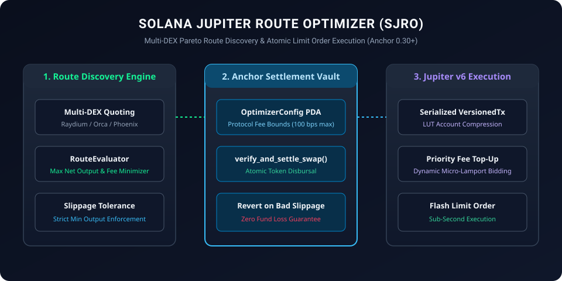

# Solana Jupiter Route Optimizer (SJRO)

<p align="center">
  
</p>

[](LICENSE)
[](https://solana.com)
[](https://jup.ag)
[](https://www.typescriptlang.org)

**Solana Jupiter Route Optimizer (SJRO)** is a production-grade Solana Anchor protocol and TypeScript client engine providing **multi-hop DEX route discovery, dynamic slippage control, and atomic limit order execution** using the Jupiter v6 swap API and Raydium concentrated liquidity pools.

---

## ⚡ Core Capabilities

1. **Multi-Hop Split-Route Discovery**: Compares deep liquidity across Orca Whirlpools, Raydium CLMM, and Phoenix orderbooks to maximize net output.
2. **On-Chain Settlement Verification**: Anchor program enforces minimum received token amounts and executes atomic PDA token escrow releases.
3. **Dynamic Priority Fee Injection**: Integrates rolling compute-budget fee estimation to ensure timely execution during high-congestion slots.

---

## 🛠 Smart Contracts & Client SDK

- **`programs/route_optimizer/src/lib.rs`**: Anchor Rust program (`Anchor 0.30+`):
  - `initialize_swap_vault`: Sets authorized swap authorities and fee split tiers.
  - `execute_routed_swap`: Verifies pre- and post-swap balances against caller slippage bounds.
- **`src/route_evaluator.ts`**: Pure TypeScript Pareto-optimal path selection engine.
- **`src/jupiter_client.ts`**: High-performance transaction bundle builder with `@solana/web3.js`.
- **`tests/route.test.ts`**: Automated unit test suite.

---

## 🚀 Quick Start

### Installation

```bash
git clone https://github.com/dishonesthero/solana-jupiter-route-optimizer.git
cd solana-jupiter-route-optimizer
npm install
npm test
```

---

## 📜 License

Licensed under the [Apache License, Version 2.0](LICENSE).
